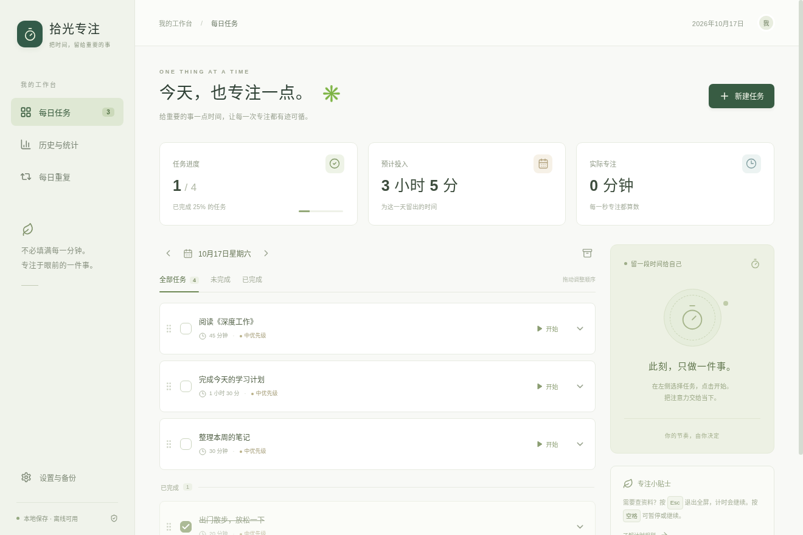

# 拾光专注

一个中文、免费、离线的 Windows 每日任务与专注计时软件。独立桌面窗口，无需账号、服务器、AI 接口或运行开发助手。

**下载软件：**[Windows 安装包](https://github.com/mengjiangwang32-cpu/-focus-timer/releases/download/shiguang-v1.0.0/Shiguang-Focus-1.0.0-Windows-x64.exe) · [Windows 免安装 ZIP](https://github.com/mengjiangwang32-cpu/-focus-timer/releases/download/shiguang-v1.0.0/Shiguang-Focus-1.0.0-Windows-x64.zip) · [发布页面与校验值](https://github.com/mengjiangwang32-cpu/-focus-timer/releases/tag/shiguang-v1.0.0)

请在 Windows 电脑上下载。安装包双击安装；ZIP 需完整解压后运行里面的 `拾光专注.exe`。源码包供开发者使用，普通使用无需下载源码或配置开发环境。



提供每日任务、手动完成、自定义时长、纯数字全屏、暂停和超时、每日重复、拖动排序、优先级、备注与子任务、历史统计及本地备份。开始过的任务固定预计预算，多次计时接着使用剩余预算。

- 普通用户：[中文使用说明](docs/使用说明.md)。安装版创建桌面快捷方式；免安装版解压后双击 `拾光专注.exe`。
- 开发与重新打包：[构建说明](docs/开发与构建.md)。
- 验收状态：[测试与验收](docs/测试与验收.md)，区分自动化、Linux 桌面验证和 Windows 待实机项目。
- 原始需求：[需求说明 V1](docs/需求说明V1.md)。

### 开发启动

安装 Node.js 24 后，在项目目录运行：

```sh
npm ci
node node_modules/electron/install.js
npm run dev
```

开发需联网安装依赖，成品软件的日常使用完全离线。只有开发需要 Node.js。云环境已经隔离，直接使用现有检出目录，不需要创建 Git worktree。

```sh
npm test          # 计时、重复任务、备份和本地存储测试
npm run build    # 构建应用界面
npm run test:ui  # Electron 桌面自动化（Linux 需要显示服务）
npm run dist:win # Windows 安装包
npm run pack:win # Windows 免安装 ZIP
```

### 实现

Electron 主进程持有唯一计时器，使用单调时钟，与界面刷新分开。电脑休眠事件会暂停；关闭和异常恢复不累计离线时间。数据在 Windows 当前用户的 `%APPDATA%\ShiguangFocus\data`，采用校验、临时文件落盘、原子替换及上一版自动副本。导入先完整校验并保留导入前副本。

界面采用 React 和本地打包资源，不引用网络字体、图片或 CDN。源码遵循 MIT 许可；Electron、React、Lucide 等第三方组件保留各自许可证。未直接复制其他计时软件的业务代码，参考和组件来源见构建说明。
